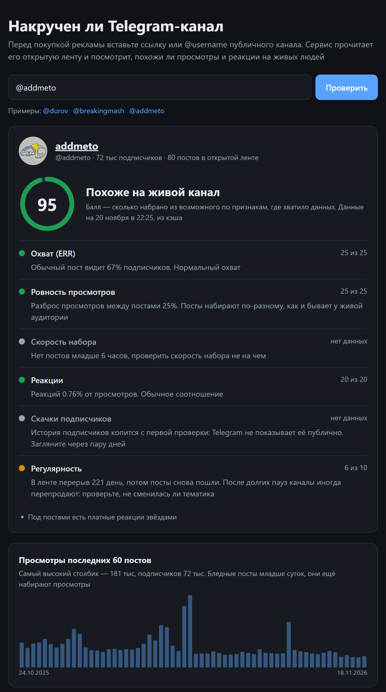

# Накручен ли Telegram-канал

**[Проверить канал → kochurin.github.io/tg-nakrutka](https://kochurin.github.io/tg-nakrutka/)**

Вставляете @username публичного канала и через несколько секунд видите балл от 0 до 100 и разбор: какой охват у постов, насколько ровные просмотры, сколько реакций, не было ли скачков подписчиков и как регулярно выходят посты. Пригодится перед покупкой рекламы, чтобы не платить за ботов



## Откуда данные

Только из открытой веб-ленты `t.me/s/<канал>`, которую Telegram показывает любому без входа. Вход в аккаунт, MTProto, сторонние API и платные базы не используются. Отсюда же ограничения: закрытые каналы проверить нельзя, а из ленты видно примерно последние 80–200 постов

Браузер не может читать t.me напрямую из-за CORS, поэтому между сайтом и Telegram стоит маленький Cloudflare Worker (папка [`worker/`](worker/)). Он скачивает несколько страниц ленты, вытаскивает число подписчиков, просмотры, даты, реакции и репосты и отдаёт их в JSON. Сам балл считается в браузере файлом [`score.js`](score.js), его можно прочитать целиком

## Как считается

Это эвристика, а не приговор. Каждый признак даёт баллы, итог — доля набранного от возможного. Признаки, для которых не хватило данных, в расчёт не идут и показаны серым. Посты младше суток в охват и ровность не входят: они ещё набирают просмотры

| Признак | Баллы | Что смотрим | Где ошибается |
| --- | --- | --- | --- |
| Охват (ERR) | 25 | Медиана просмотров поста делённая на число подписчиков. Нормой считаем 8–80%, ниже 2% похоже на купленных или мёртвых подписчиков, выше 120% похоже на накрученные просмотры | Старые большие каналы честно теряют охват. Маленькие каналы и посты, которые разошлись репостами, честно набирают больше подписчиков |
| Ровность просмотров | 25 | Разброс просмотров между постами (коэффициент вариации без 10% крайних значений). Накрутка пакетами даёт почти одинаковые цифры у всех постов | В Telegram просмотр засчитывается, когда пост появился на экране, поэтому у частых новостных каналов кривая ровная и без накрутки. Для каналов от 8 постов в день пороги мягче |
| Скорость набора | 10 | Пост младше 6 часов уже набрал не меньше просмотров, чем обычный пост за сутки | Бывает у срочных новостей и постов, которые закрепили или разослали. Не считается у каналов с медианой меньше 300 просмотров |
| Реакции | 20 | Медиана реакций к просмотрам. Нормой считаем 0,2–8%. Почти ноль при больших просмотрах — смотрят боты. Больше 15% — похоже на докрученные реакции | У новостных каналов реакций мало. Если реакции выключены, признак не считается. Платные реакции звёздами учитываются отдельно |
| Скачки подписчиков | 10 | Изменение больше 5% в сутки и больше 300 человек. Резкий рост похож на покупку, резкое падение — на чистку ботов Telegram | Telegram не показывает историю публично, поэтому Worker сам записывает число подписчиков раз в сутки, когда канал кто-то проверяет. В первый раз данных нет. Вирусный пост тоже даёт резкий рост |
| Регулярность | 10 | Как давно был последний пост и нет ли многонедельной паузы, после которой лента ожила | Пауза не доказывает продажу канала, это повод посмотреть старые посты |

Итог: от 75 «похоже на живой канал», 50–74 «есть странности», ниже 50 «много признаков накрутки»

Пороги подобраны вручную на публичных каналах разного размера: от небольших до новостных с миллионами подписчиков. Каналов с доказанной накруткой у нас нет, поэтому сторона «накручено» проверена только на синтетических данных в [`tests/`](tests/). Если нашли канал, где оценка явно врёт, откройте issue с его username: пороги будем править по таким примерам

Чего сервис не видит: число пересылок поста (его нет в веб-ленте), географию и источники подписчиков, комментарии. Хорошая накрутка с живыми людьми из мотивированных сервисов по этим признакам не ловится

## Запустить у себя

Нужны Node.js 18+ и Python (только для локального статического сервера)

```
cd worker
npx wrangler d1 execute tg-nakrutka --local --file=schema.sql
npx wrangler dev
```

Во втором терминале из корня:

```
python -m http.server 8080
```

Откройте `http://127.0.0.1:8080`. На localhost сайт сам ходит в `http://127.0.0.1:8787`

Тесты: `npm test`

## Worker

- `GET /api/channel?u=<username>` — данные канала в JSON
- Кэш: ответ по каналу хранится час в Cache API Cloudflare, повторные проверки в Telegram не ходят
- Лимит: не больше 10 свежих проверок в минуту с одного адреса (кэшированные ответы не считаются)
- База D1 хранит только `username`, дату и число подписчиков. IP и данные посетителей не сохраняются

Деплой своего экземпляра:

```
cd worker
npx wrangler d1 create tg-nakrutka        # вписать database_id в wrangler.toml
npx wrangler d1 execute tg-nakrutka --remote --file=schema.sql
npx wrangler deploy
```

В `index.html` поменяйте адрес `API` на свой, в `worker/src/index.js` — список разрешённых сайтов в `ALLOWED`

## Лицензия

MIT
